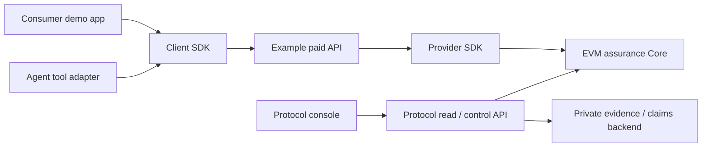

# AssurePay local product roadmap

Date: 2026-10-23. Direction accepted under EVM-043 from the user's request for
provider/client integrations, protocol dashboards and a separate consumer demo.
M1–M7 remain accepted. M8 defines product boundaries; later implementation gates
are not yet proven. Everything in this roadmap is local-only unless separately
authorized. No public publishing, hosting, campaign or real-fund use is implied.

## Product surfaces

1. **Provider SDK:** a service developer adds assured payment/receipts to an
   ordinary byte handler. It owns integration lifecycle, durable payment/result
   state and configured signing dependencies. Business logic stays in the service.
2. **Client SDK:** an application or agent discovers a configured service quote,
   obtains explicit approval, makes one paid attempt, validates its result and
   retrieves the original result after interruption. It owns payer-side state.
3. **Agent adapter and skill:** a thin framework-neutral tool adapter plus a
   portable SKILL.md usage artifact, both over the same client SDK approval and
   recovery rules. The skill documents the real tools, inputs, consent and
   uncertainty/retrieval behavior; it is not just a renamed SDK README. It has no separate payment engine,
   arbitrary transaction tool, private-key output or adjudication capability.
4. **Protocol API and console:** one local role-aware protocol application for
   provider accounting, admin controls, runtime operations and adjudication.
   The backend enforces operation-specific authority; navigation grants none.
5. **Consumer demo app:** a separate application with its own user workflow that
   uses only the public client SDK/adapter and calls the example provider over
   HTTP. It does not import protocol/provider internals or act as an admin UI.

The browser UI calls a local application backend. First SDK targets are Node
applications/agent hosts, matching current filesystem and encryption behavior.
Browser-native wallets/storage and production custody are not claimed by this
milestone. Keys never enter UI bundles or agent tool responses. The initial local signing
target is role-specific Node actor adapters behind the demo/application backend,
using only fresh local test actors. M11 must freeze the actor/session binding,
preview/confirmation, secret isolation and same-origin/CSRF behavior before any
browser-initiated write is implemented. A client-provided role name is never
authorization. Demo test actors
are fresh local accounts and clearly labelled; there is no production login claim.

## What is already proven, and what is not

M2 Core, M3 x402/receipts, M4 encrypted claims, M5 historical native public proof,
M6 developer composition and M7 local HTTPS all remain accepted. Reuse those
semantics rather than creating another quote, settlement, refund or recovery
implementation.

Current developer-pilot is private, has no built package exports/declarations,
and imports sibling source files. Its reusable functions are not yet standalone
SDK artifacts. Current buyer.prepare signs before returning; it is not an
unsigned consent preview. Current status API accepts one known coverage ID and
has no list/summary/provider/policy dashboard read model. Current sender only
supports fileClaim/finalizeClaim. M6's admin=relayer check is a runtime coupling,
not a requirement of Core. These are source findings, not completed upgrades.

## Phase sequence and gates

| Phase | Deliverable | Completion gate |
|---|---|---|
| M8 Product boundaries | Component map, role/action matrix, runtime/approval rules, demo journey and phase ownership | Source-grounded independent review closes contradictions; detailed SDK packet is the exact next action |
| M9 Provider integration | Installable Node provider package, bounded configuration/lifecycle, separate example service, integration guide | Packed artifact installs outside the repo with built JS/types and no deep source imports; an actual local EVM paid call, receipt and restart recovery work through its public API |
| M10 Client and agent integration | Installable Node client package, unsigned preview → explicit approval → authorize/persist → one send → retrieve; payer-scoped evidence/claim and anchored coverage/outcome/token-balance reads, one thin agent adapter and portable SKILL.md | Separate consumer uses public exports only; denied approval signs nothing; actual local EVM purchase works; fresh-process recovery adds no payment/signature/handler; tool cannot bypass approval; skill/tool smoke journey follows the same public API and records no private key/signature |
| M11 Protocol application API | Anchored summary/list/provider/policy read models, role-specific fixed actions, separate admin/relayer composition | Actual local Core reads match at one canonical head; unavailable data fails explicitly; every supported action has authorized/wrong-role and same-hash recovery checks |
| M12 Protocol console | Provider, admin, operator and adjudicator views over M11 | Every shown amount/action is backed by API/chain state; explicit confirmation and real role enforcement; meaningful browser journey checks, including failure and unavailable states |
| M13 Consumer demo app | Separate end-user workflow consuming M10 and the example provider, with a visible agent/tool execution option | Full actual local flow: quote/approve/pay/result; signed failure/claim/explicit decision/refund; interrupt/retrieve without a second charge; no internal/deep imports or invented balances |
| M14 Presentation rehearsal | One-command local launch, deterministic scenarios, architecture/SDK examples, evidence, demo script/video and submission material | Repeatable complete rehearsal; claims trace to code/evidence; clear prior-work/event-work and AI-assistance attribution |

One phase at a time. Each implementation packet freezes exact paths, interfaces,
checks and non-goals before dependent work. Independent work within the active
phase can be delegated to Luna(high); primary reviews and verifies before the
checkpoint commit/push. A roadmap row does not count as an implementation gate.

M9 provider tests may temporarily use the accepted in-repo M3 buyer as a harness;
that does not accept M10. From M10 onward, the example consumer must import the
packed client package. Cross-package SDK internals may depend on explicitly
packaged shared runtime modules; emitted artifacts must not need the monorepo,
test fixtures, tsx, source aliases or M5 campaign scripts. Package names/build
mechanism are frozen by the respective detailed packet. npm publishing is not
required: local tarball consumption proves installation without a registry push.

## Role and action contract

| Actor | Views / actions to present | Actual authority and boundary |
|---|---|---|
| Buyer / application | Quote, explicit payment approval, receipts, own coverage, evidence, claim and original-result retrieval | Payer authorizes its payment and files its own live coverage claim; no refund decision or protocol admin power |
| Provider owner | Configured service/policy, earnings derived from events, free/locked collateral, relevant coverage/claims; deposit and free-stake withdrawal when implemented | Only registered provider owner may withdraw that provider's free stake. Payout address receives earnings but grants no owner privilege |
| Protocol admin | Provider/policy registration and global pause state; fixed admin controls when implemented | Core admin alone registers providers/policies and sets pause. Admin is not automatically an adjudicator. Policies/providers are registered, not silently editable |
| Runtime operator | Readiness, bounded projection health, transaction reconciliation, evidence of unsettled/unknown work, process lifecycle | Operator is an application responsibility, not a Core role. It inherits no admin/refund/private-evidence privilege; local process controls are separately bounded |
| Adjudicator | Pending claim review, authorized evidence, explicit rejection/partial/full refund and reason | Only configured adjudicator finalizes a pending claim under the existing outcomes and amount constraints |

Any account can fund the pool or deposit stake for an existing provider (positive
amounts only); expiry closure is
permissionless for eligible expired coverage. UI action policy can be narrower,
but must not misstate contract authority. Every write is selector/actor/context
bound; no generic address/calldata send endpoint. Existing claim sender cannot
be presented as supporting other controls until a gated adapter implements them.

Provider/API outcomes and opaque evidence are not on-chain truth. General
summary/list responses exclude private evidence, signatures and decision reasons.
Evidence access retains existing actor/operation authorization. A persisted
reason/detail read API, if needed, must be explicitly scoped in M11; it does not
exist today. Role switching in a local demo is a test harness control, not auth.

## Shared product rules

- Unsigned preview shows canonical service URL, provider/policy/Core/token,
  atomic price, relevant coverage terms and body/request identity. No signer is
  called before explicit app/user approval. Revalidate bindings/terms before
  signing; a changed quote needs a fresh approval.
- Per-request maxGross remains a per-request payer cap. An agent adapter also
  needs explicit host approval for each new payment and a defined session limit.
  It cannot expose raw keys, signatures, calldata or private journal paths.
- A timed-out/unknown paid attempt leads to retrieval/reconciliation of the same
  request/hash. No automatic new request, authorization, send or replacement.
- Read models identify their canonical observed block. Use atomic integer
  amounts, bounded pages and explicit unavailable/stale states. Wallet balances
  are not cumulative earnings. No invented APY, uptime, claim accuracy or risk
  score. Derived metrics state their event range and provenance.
- Core solvency is balance >= provider stake + pool assets, not unconditional
  equality when surplus donations exist; also show pool >= reserved and total
  stake >= locked. Existing exact-fixture equality evidence remains historical.
- Keep online relayer separate from admin in a NEW product composition path
  before representing them as separate controls. Existing M6 checkPilot /
  startPilotProvider still couple these roles; preserve their compatibility and
  do not present them as already separated.
- Initial trust/custody is a clearly labelled local demo backend with fresh
  isolated actors. Browser-wallet support requires its own storage/signing gate.
  Provider, client, ingress and console must receive only their necessary secrets.

## Reference demo journey

Use one small deterministic paid data service as the initial example, such as
profiling an uploaded CSV dataset (row/column counts and missing-value summary).
This makes the service do useful business work without an external model/API.
The exact handler/input contract is chosen in M9; this example is not an oracle
or subjective quality/adjudication system.

The consumer app asks the service for analysis through the client SDK/agent.
A successful call returns a verifiable report/receipt and active coverage. A
separate controlled provider-failure scenario returns a signed500 and permits
the payer to submit evidence/file its own claim using the M10 client
SDK's payer-scoped methods. The presenter then switches to the separate M12
adjudicator console to choose an explicit outcome/refund. The consumer app
reads the resulting coverage/refund and actual payer token delta through its
client APIs. It never obtains adjudicator/admin powers or imports console
implementation. The complete journey spans those separate applications. Another scenario interrupts the
consumer and retrieves the original result without another charge. Protocol
console views explain the same payment, collateral/reservation and claim IDs. M10 must expose bounded
read-only coverage/outcome and payer token-balance methods with observation
anchors, so the consumer needs no deep import or independent balance logic.

Success, provider failure and transport uncertainty are different states. A500
is not an automatic adjudication/refund. Fresh demo scenarios use fresh local
IDs, while recovery always uses the original identity. No random service
selection, autonomous spending, multiple chains/assets, hosted accounts,
subjective AI adjudication or production launch is required for this journey.
